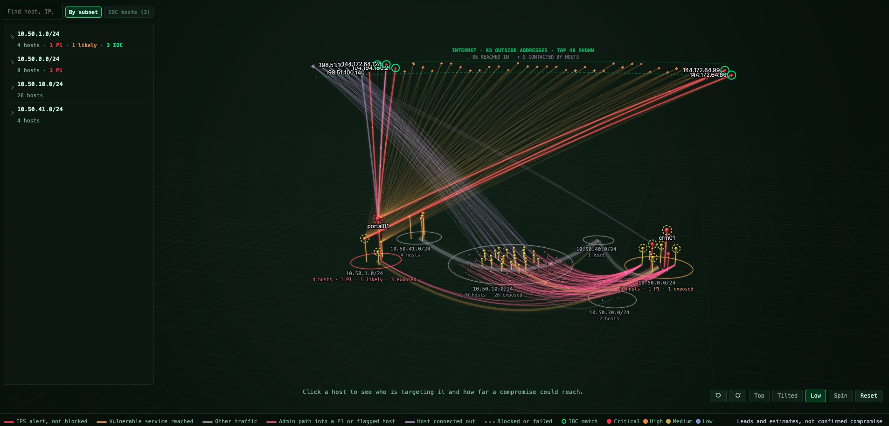
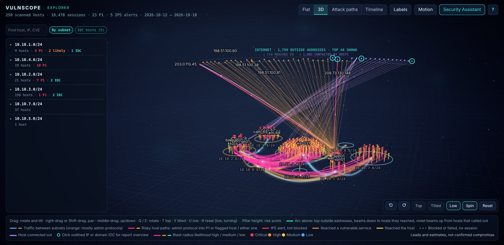

# Múcaro VulnScope

**Network telemetry and vulnerability scans, correlated into reports for system owners.**



VulnScope reads the logs and scans you already have and shows which vulnerable services were
actually reached, from where, and what happened next. Each run writes an executive summary, a
technical report and an interactive Explorer. It never scans, probes or contacts the hosts in your
data.

This repository is **VulnScope ULTRA**: VulnScope MAX with a faster engine and the same reports.
What changed and what did not is in [docs/ULTRA.md](docs/ULTRA.md).

> **Proof of concept, for local use.** The upload page has no login and can read any folder your
> account (or the container) can. It listens on `127.0.0.1` only. Read
> [Upload page security](ARCHITECTURE.md#upload-page-security) before running it anywhere shared.

The command-line package is `vulnflow`.

## Quickstart

**Docker** (Linux, macOS, Windows, air-gapped networks). Download `compose.yaml` and `env.example`
from the [latest release](https://github.com/bayanilla/vulnscope_max/releases/latest) into an empty
folder, then:

```sh
cp env.example .env      # optional: data folder, runs folder, port, memory
docker compose pull
docker compose up -d
```

Open **http://127.0.0.1:8765/**, enter or browse to a folder of logs and scans, and click
**Analyze folder**. Stop it with `docker compose down`. The image includes
[Zeek](https://zeek.org), so packet captures work out of the box. Compose shares your home folder
read-only; set `VULNSCOPE_BROWSE` in `.env` to share an evidence drive instead (see
[Docker container](ARCHITECTURE.md#docker-container)). To build from source, clone this repository,
`cp .env.example .env` and run `docker compose up -d`. With no internet, load the image from the
release file instead; see [Air-gapped networks](ARCHITECTURE.md#air-gapped-networks-and-enclaves).

**Python 3.10 or later:**

```sh
python3 -m pip install -r requirements.txt   # DuckDB, the one dependency
python3 -m vulnflow serve                    # http://127.0.0.1:8080/
```

`python3 start_upload_page.py` does the same, picks a free port and opens the browser. Packet
captures also need Zeek on the PATH (or `VULNSCOPE_ZEEK=/path/to/zeek`). If the page doesn't load,
see [Troubleshooting](docs/TROUBLESHOOTING.md).

## See the output first

`example_output/` holds a finished run on a synthetic 250-host network. Open `explorer.html`,
`executive_summary.html` or `technical_report.html` in your browser, no install needed. To analyze
a bundled sample:

```sh
python3 -m vulnflow analyze samples/gootloader_seo_poisoning -o gootloader_output
python3 -m vulnflow compare-sample    # seven site reports from two companies, plus their comparison
```

Samples include a Gootloader intrusion, a two-company comparison, and ARTEX and CyberStrikeAI
agentic intrusions replayed from public reporting. All sample data is fabricated. See
[the sample guide](samples/README.md) and the [screenshot gallery](screenshots/README.md).

## How it works

1. **Read:** every file in the folder is detected by content and streamed into Parquet, so
   multi-GB log sets fit in bounded memory.
2. **Correlate:** DuckDB de-duplicates sessions seen by more than one sensor and, when scans are
   present, matches vulnerable services to the traffic that reached them.
3. **Report:** executive summary, technical report, Explorer, and CSV and JSON for ticketing and
   automation.

With telemetry alone, VulnScope reports observed connections, IPS/IDS alerts and exact IOC matches,
and marks vulnerability status as **unknown**. Details: [Architecture](ARCHITECTURE.md) and
[Methods](METHODS.md).

## What it reads

| Input | Formats | What it adds |
| --- | --- | --- |
| Zeek | TSV or JSON, Zui/Brim exports, Filebeat via Kibana CSV or NDJSON | Connections and protocol logs |
| Palo Alto | TRAFFIC and THREAT | Sessions and IPS alerts |
| Suricata | EVE JSON | IDS alerts |
| AWS VPC Flow Logs | Text with or without a header, CloudWatch and Athena exports, local Parquet; plain or `.gz` | Connections, with both directions of a session joined |
| Flow records | nfdump, SIEM CSV exports | Connections |
| Packet captures | `.pcap`, `.pcapng`, plain or `.gz` | Run through Zeek offline |
| Nessus | `.nessus` or CSV | Vulnerability findings |
| IOC list | CSV: `type,indicator[,source_url]` | Exact matches on IPs, domains, URLs, hashes, CVEs, packages |
| Network map | `network_map.csv` (`cidr,name,type`) | Names cloud networks such as AWS VPCs |
| Known scanners | `known_scanners.csv` (`address,name`) | Labels your own scanners "expected" instead of "review" |

If detection guesses a format wrong, force it with `--format file.csv=paloalto`.
[Methods](METHODS.md#inputs-and-normalization) lists what each source can and cannot contribute.

## Analyze your data

On the upload page:

1. Enter a folder path or click **Browse…**, then **Analyze folder**. Files are read where they
   sit; nothing is copied. You can also upload files (up to 1 GB each by default).
2. Optionally list your internal networks. The default is RFC 1918, CGNAT, loopback, link-local and
   ULA ranges.
3. Optionally open **Report details** to name the run and its network. These label the reports and
   group runs in Compare reports.

From the command line:

```sh
python3 -m vulnflow analyze /path/to/case -o out --internal-net 10.0.0.0/8
python3 -m vulnflow explore /path/to/case        # analyze and open the Explorer
```

**Several sites or companies.** One analysis treats a folder as one network. To keep sites apart,
give each its own folder and add a `sites.csv`; see [Compare reports](docs/COMPARE.md#several-sites-in-one-folder).

**Large inputs.** DuckDB sizes itself to the machine and spills to disk; plan for free disk about
the size of the uncompressed logs. `--workdir` (or `VULNSCOPE_WORKDIR`) moves the temporary files.
See [Large inputs](ARCHITECTURE.md#large-inputs-and-resource-sizing).

## Read the results

Every scored finding has a priority from **P1** (act now) to **P4** (routine) and a plain-English
rationale built from CVSS, exploit availability, observed exposure and blast radius. Indicators are
graded so reports never overstate them:

- **Lead, not confirmed:** worth investigating, for example a return connection to an outside
  address that reached the vulnerable service, or an unblocked IPS/IDS alert.
- **Likely exploitation:** an unblocked alert on the vulnerable service **and** follow-on behaviour
  from the host. Reports ask for incident response and host forensics; they never state a
  compromise as confirmed.

No traffic means "not observed by these sensors", not "safe". Scanned hosts never seen on the wire,
and active servers never scanned, are listed as coverage gaps. The reports also warn when the
sensor looks unreliable (packet loss, or one-direction capture).

**The Explorer** (`explorer.html`, one offline file) shows the same run as a 3D or flat map, an
Attack paths view of the likeliest ways in, and a Timeline of every flow. Click a host to see who
it talked to inside and out. Press **?** in any view for help; the
[Explorer guide](docs/EXPLORER.md) covers the controls.



For a guided walk-through, analyze the Gootloader sample and follow `hr-ws-07` in the Timeline.
[Methods](METHODS.md) explains every score and estimate.

## What each run writes

- Executive summary and technical report, as Markdown and standalone HTML (print or save as PDF
  from your browser)
- `explorer.html`, the offline Explorer
- `correlated_findings.csv` for ticketing and `results.json` for automation
- Normalized inputs under `normalized/` (skip the large copies with `--no-normalized-copies`)
- `hostile_activity.svg`, and the Security Assistant brief and audit log when used

To reopen a saved run with the current version, choose its output folder on the upload page and
click **Open report**. Keep `explorer.html` with `results.json`: it holds the traffic the Explorer
is drawn from.

## More features

- **Compare reports:** find IOCs and vulnerabilities shared across runs and networks, and draw
  every network on one map. [Guide](docs/COMPARE.md)
- **Security Assistant:** ask about hosts, CVEs and IOCs. Offline by default with no AI and nothing
  sent; optionally Claude, OpenAI or a local model. [Guide](docs/SECURITY_ASSISTANT.md)
- **Branding and themes:** your name and logo on every report, behind a password, and seven
  themes. [Guide](docs/BRANDING.md)

## Privacy

| Topic | What to expect |
| --- | --- |
| Target contact | Never scans, probes or resolves anything in your data. Zeek reads captures offline. |
| Outbound connections | Only four, each tied to a feature: IOC article previews, Cloudflare Radar, a hosted Security Assistant model, and article briefs. See [Methods](METHODS.md#privacy-and-outbound-network-use). |
| Offline mode | `VULNSCOPE_OFFLINE=1` turns off article previews only. On air-gapped systems, also leave Radar and AI providers unconfigured. |
| API keys | Held in memory only, never written to disk, logs or reports. |
| Retention | Runs stay on disk, readable by your account only, until you delete them. Reports are not encrypted. |
| Deployment | Local use. A shared server needs `--allow-remote` behind your SSO proxy and its own security review. |

Every numeric bound is listed in [Configured limits](docs/LIMITS.md).

## Updating

Run `docker compose pull && docker compose up -d` (from source: `git pull`, then
`docker compose up -d --build`), then analyze your data again. Each run keeps the version it was
made with. Settings, runs and branding are kept. Coming from vulnScope PRO? See
[UPGRADE.md](UPGRADE.md).

## Documentation

| Doc | Covers |
| --- | --- |
| [Troubleshooting](docs/TROUBLESHOOTING.md) | Port in use, proxies, updates that don't show, Docker on macOS |
| [Methods](METHODS.md) | Formats, correlation and scoring, Explorer estimates, what VulnScope cannot establish |
| [Architecture](ARCHITECTURE.md) | Pipeline, large inputs, Docker, air-gapped bundle, upload page security |
| [Explorer](docs/EXPLORER.md) | Views, controls, deep links, supported browsers |
| [Compare reports](docs/COMPARE.md) | Comparisons, several sites, the all-networks map |
| [Security Assistant](docs/SECURITY_ASSISTANT.md) | Providers, redaction, article briefs, command-line use |
| [Branding](docs/BRANDING.md) | Name, logo, password, themes |
| [Development](DEVELOPMENT.md) | Tests, benchmarks, builds and releases |
| [Local API](API.md) | The upload page's HTTP routes |
| [Configured limits](docs/LIMITS.md) | Every numeric bound in one table |
| [Changelog](CHANGELOG.md) | Notable changes per release |

## License

MIT. See [LICENSE](LICENSE). The Múcaro browser tab icon keeps its original MIT attribution in
[THIRD_PARTY_NOTICES.md](THIRD_PARTY_NOTICES.md).
