# Screenshot gallery

Examples of the upload workflow, reports, and Explorer. Click a preview to open the full-size image.

## Diagrams

### Architecture

<a href="../docs/diagrams/vulnscope-architecture.png">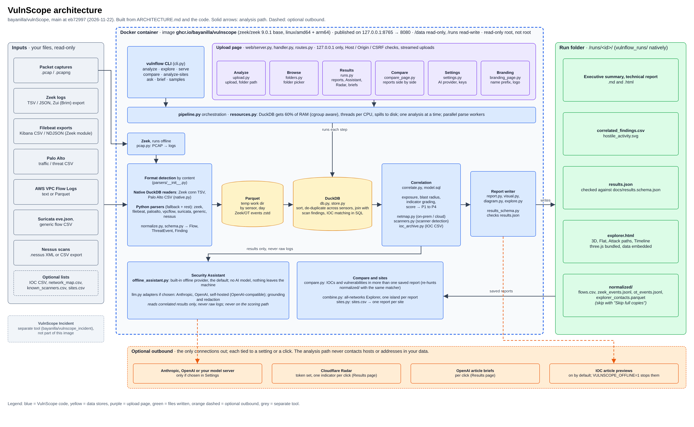</a>

Inputs, the Docker image, the analysis chain from parsers to reports, the upload page, the Security Assistant, Compare, the run folder and the optional outbound connections.

### End to end

<a href="../docs/diagrams/vulnscope-end-to-end.png">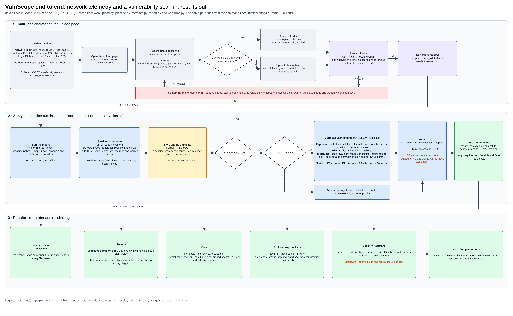</a>

Submitting network telemetry and a vulnerability scan, the analysis steps, and the results. The draw.io files are in [docs/diagrams](../docs/diagrams/).

## Explorer and Security Assistant

### Security Assistant drawer

<a href="security_assistant.jpg">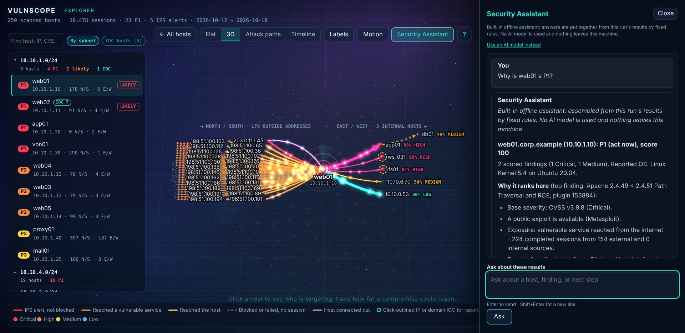</a>

The focused host graph sits beside a Security Assistant answer about the findings and observed connections.

### 3D Explorer

<a href="explorer_3d_artex.jpg">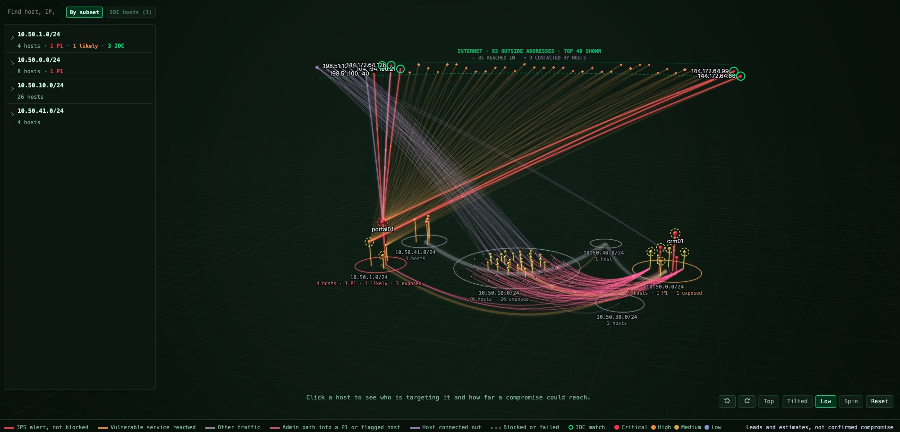</a>

The ARTEX sample in 3D: subnets as platforms, hosts as pillars sized by risk, and the outside addresses that reached in on the INTERNET arc.

### Explorer overview

<a href="explorer_current_overview.jpg">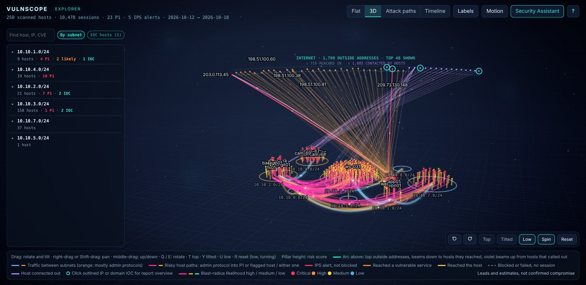</a>

The Explorer opens in 3D: each subnet is a platform, hosts are pillars sized by risk, and the top outside addresses sit on the INTERNET arc. The host list on the left is grouped by subnet.

### Focused host

<a href="explorer_current_host.jpg">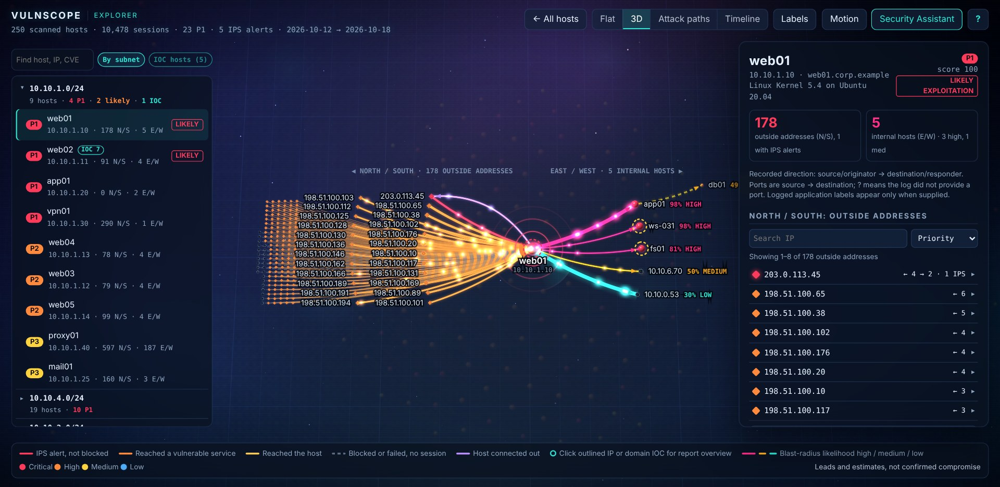</a>

Outside addresses appear to the left, connected internal hosts to the right, and the host details in the pane.

## Upload workflow and reports

<a href="upload_current.jpg">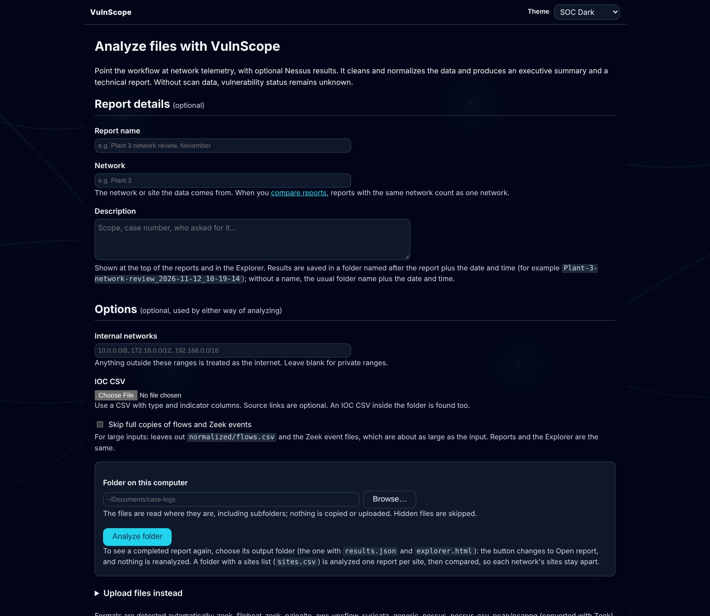</a>

The upload page: optional report details, then Options used by either way of analyzing (internal networks, an IOC CSV, skipping the large copies), a folder to analyze in place, and uploads folded under **Upload files instead**.

<a href="upload_olive_drab.jpg">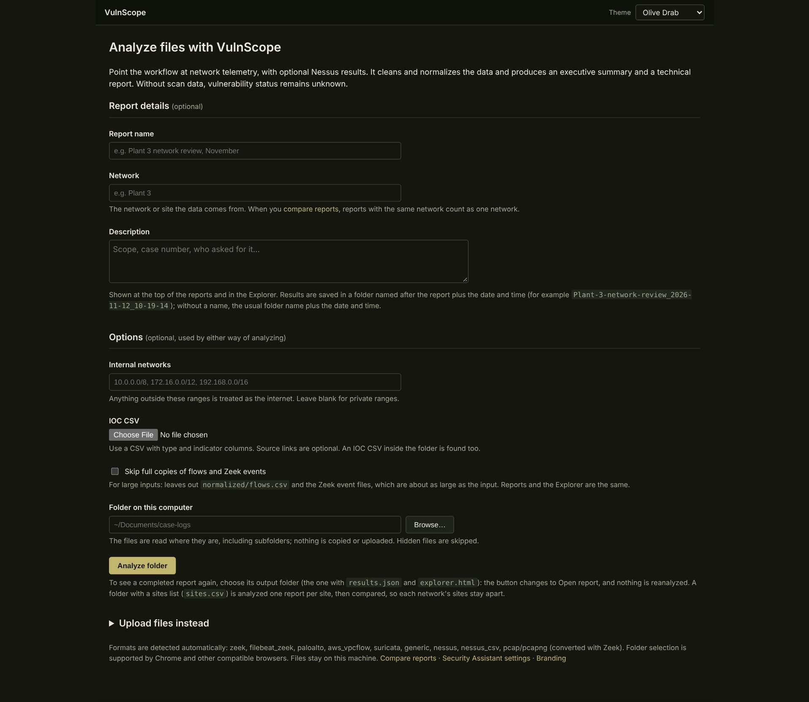</a>

Olive Drab uses a subdued map backdrop; SOC Dark and Matrix use signal lines, while Light uses a soft gradient.

<a href="results_current.jpg">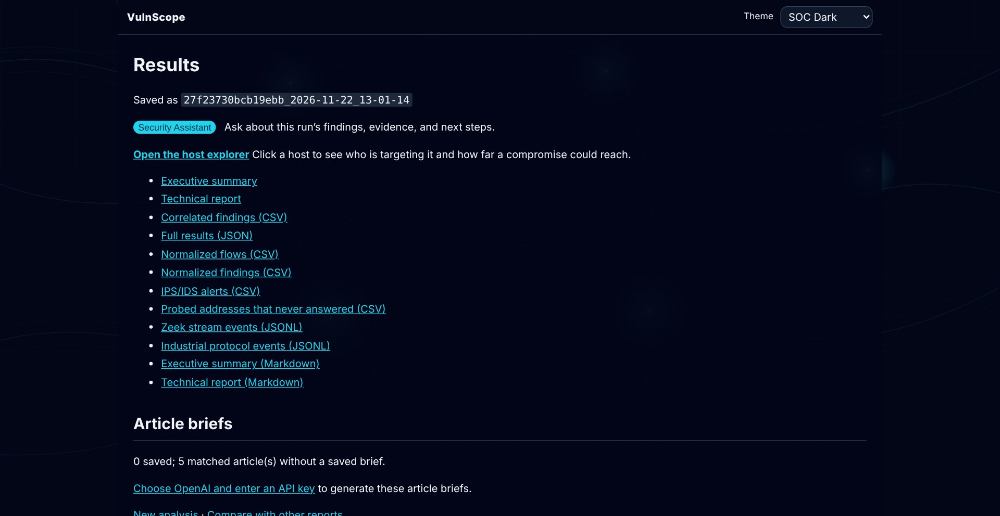</a>

The results page links to the reports and Explorer and opens Security Assistant in a right-side drawer.

<a href="results_assistant_drawer.jpg">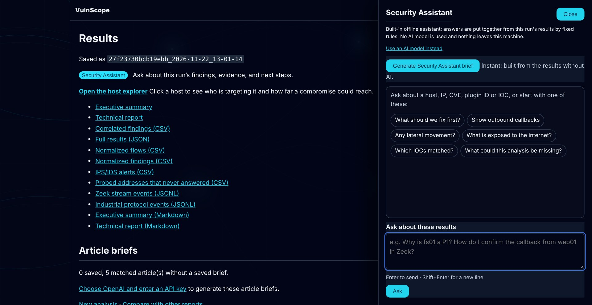</a>

<a href="executive_dark.png">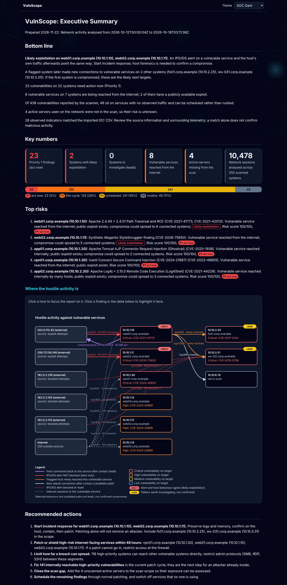</a>

The dark executive summary with key numbers, top risks, an activity diagram, and recommended actions.

<a href="executive_light_detail.png">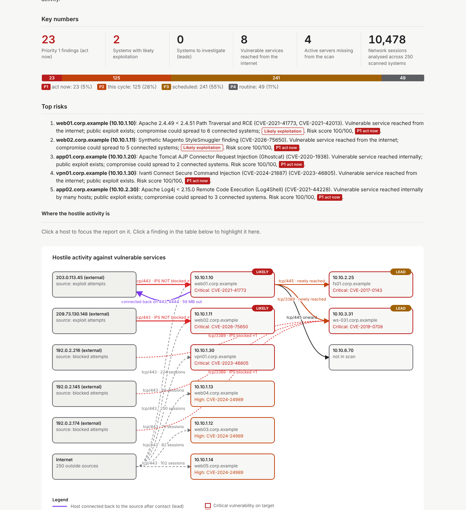</a>

A light-theme close-up of the executive report's key numbers, top risks, and activity diagram.

<a href="technical_dark.png">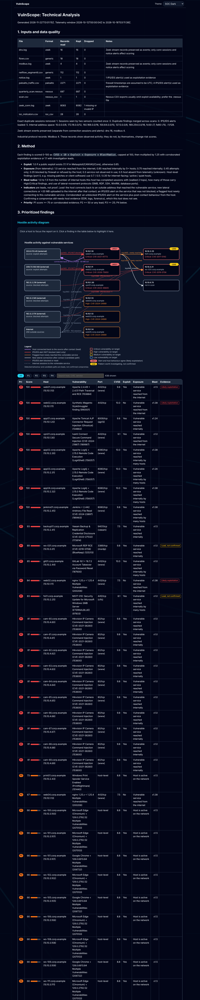</a>

The dark technical report covering data quality, prioritized findings, and per-host evidence.
